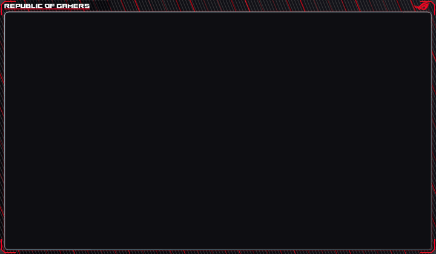
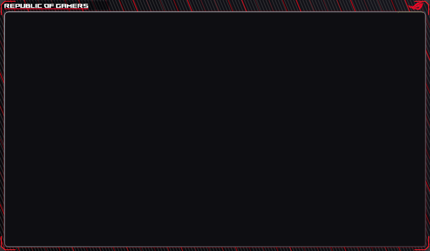
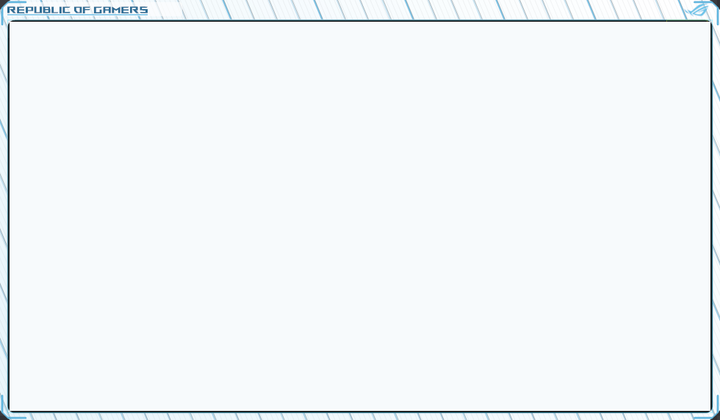
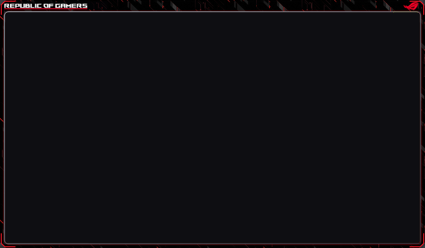
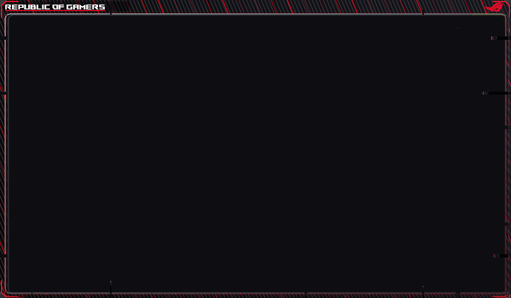
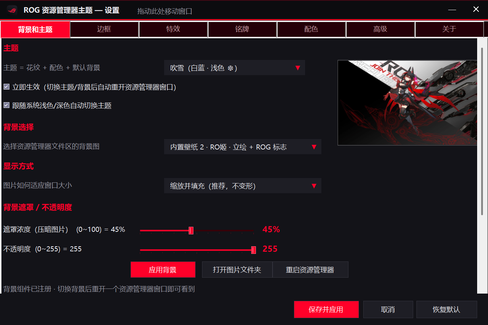
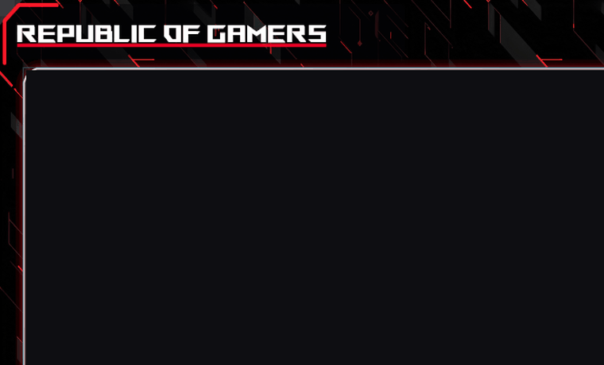

<div align="center">

# ROG Explorer Theme

**支持Windows 10/11 的资源管理器主题边框**

零注入 · 外置覆盖层 · 双主题 · 一键还原




</div>

---

## 这是什么

一个资源管理器窗口美化工具。在窗口**外侧**叠加一层自绘边框，**不注入进程、不 Hook 任何 API**，不会受到目标程序崩溃或系统更新影响。


---

## 特性

| | |
|---|---|
| **双主题** | RO姬（红黑）· 吹雪（白蓝），可跟随系统浅色/深色自动切换 |
| **三种边框** | 刀锋刃片 · 碳纤维材质 · 纯色，配色随主题联动 |
| **背景系统** | 文件列表 + 主文件夹双图层，4 张内置壁纸 + 自定义图片 |
| **故障特效** | 可调 glitch：切片错位 + 红青色差 + 扫描条 |
| **窗口留白** | 边框与窗口的上下/左右间距独立可调 |
| **完全可逆** | 卸载自动还原注册表、强调色、外壳扩展，不留残留 |
| **开机自启** | 4 种方式：注册表 / 启动文件夹 / 计划任务 / 关闭 |

<details>
<summary><b>更多细节</b></summary>

- 45° 切角 + 圆角可独立调节，角落包围线与边线同色
- 铭牌：字体、字号、下划线、Logo、底板透明度
- 背景遮罩浓度按主题自动选择（深色=黑 / 浅色=白）
- 引擎 178 KB，全部代码 4700 行 C#，仅依赖系统自带 .NET Framework
- 设置界面 7 个页签，所有参数实时预览

</details>

---

## 预览

| RO姬 · 深色 | 吹雪 · 浅色 |
|:---:|:---:|
|  |  |

| 碳纤维边框 | 故障特效 |
|:---:|:---:|
|  |  |



### 故障特效 · 边框特写

碳纤维边框近距离演示 · 通道分离的真实红蓝色差（左：RO姬 · 黑 / 右：吹雪 · 白）




---

## 安装

**方式一 · 图形安装（推荐）**

下载 `RogHime-Setup-v2.2.0.exe`，双击安装

**方式二 · 便携安装**

下载 `RogHime-Explorer-v2.2.0-win64.zip`，解压后双击 `安装.bat`。

> [!NOTE]
> 首次会请求一次管理员权限（注册资源管理器背景扩展需要）。主题本身写在用户目录，不需要提权。

> [!IMPORTANT]
> 主文件夹背景依赖第三方 Windhawk mod，属于可选增强。不影响正常使用文件列表背景。

---

## 卸载

设置界面 → **关于** → 卸载按钮，或从 Windows「设置 → 应用」卸载。

将会还原：系统强调色、DWM 配色、开机自启项、外壳扩展注册，并删除安装目录。

---

## 结构

```
src/
├── Engine/          引擎（C# / WinForms / GDI+）
│   ├── Program.cs       主逻辑 · 托盘 · 调度
│   ├── Art.cs           边框绘制 · 刃片 · glitch
│   ├── Brand.cs         铭牌 · 字体转矢量
│   ├── Svg.cs           迷你 SVG 解析器
│   ├── Overlay.cs       分层覆盖层窗口
│   ├── Config.cs        配置 + 主题色板
│   ├── AutoStart.cs     开机自启四种方式
│   └── Native.cs        Win32 封装
└── Setup/           安装向导（单文件 exe）

assets/              图标 · 字体 · 壁纸 · 材质
ExplorerBg/          第三方外壳扩展（MIT）
```


---

## 已知行为

> [!WARNING]
> 背景图由外壳扩展加载后会**缓存在内存**。切换背景或主题后，已打开的窗口不会立即刷新——**新开一个窗口**或重启 Explorer 即可。

---

## 致谢

- [ExplorerBgTool](https://github.com/Maplespe/ExplorerBgTool) — 文件列表背景扩展（MIT）
- [Windows 11 File Explorer Styler](https://github.com/m417z/winlhawk-mods) — 主文件夹背景支持
- [simple-icons](https://simpleicons.org/) — ROG图标（CC0）
- AsusRog 字体 — 版权归华硕所有，仅供个人美化使用

---

<div align="center">
<sub>Zhuo Yao个人爱好者作品，与华硕 / ROG 官方无任何关联。</sub>
QQ:83015102
</div>
